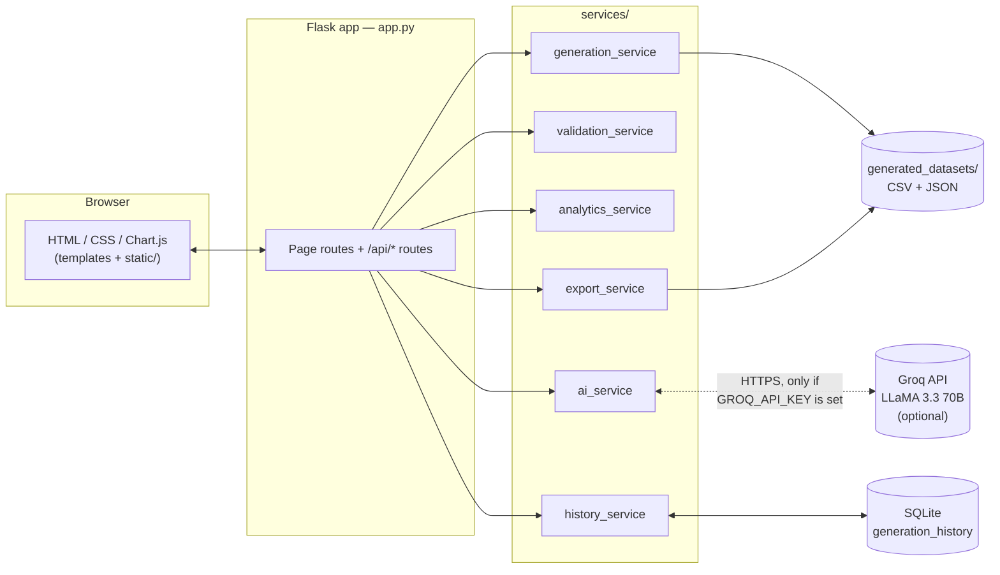
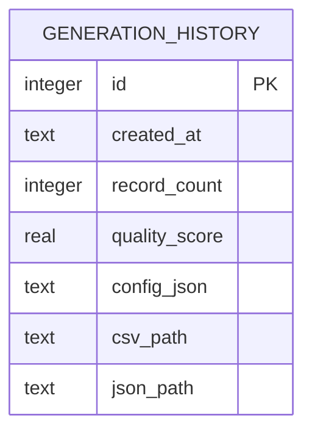

# LeaseSynth AI

**Synthetic Commercial Lease Transaction Data Generator**

> ⚠️ **Every record this application produces is synthetic.** No real tenants,
> properties, lease agreements, or personal information are used or
> represented anywhere in this project. Rent figures are illustrative
> outputs of configurable statistical assumptions — not verified market
> valuations.

Commercial real estate firms want to test lease-analytics models across
varied lease terms and tenant scenarios, but real lease data is
confidential and limited in volume. LeaseSynth AI generates realistic,
fully synthetic lease transaction data — with configurable property
types, locations, durations, and market conditions — so analytics and ML
teams get the volume they need without ever touching a real agreement.

---

## Contents

1. [Features](#features)
2. [Architecture](#architecture)
3. [Project structure](#project-structure)
4. [Getting started](#getting-started)
5. [Configuring the Groq API key](#configuring-the-groq-api-key)
6. [Running the app (Windows PowerShell)](#running-the-app-windows-powershell)
7. [Using LeaseSynth AI](#using-leasesynth-ai)
8. [Data model](#data-model)
9. [API reference](#api-reference)
10. [Testing](#testing)
11. [Design notes & limitations](#design-notes--limitations)

---

## Features

| # | Feature | Notes |
|---|---------|-------|
| 1 | **AI scenario generator** | Describe a scenario in plain English; Groq-hosted LLaMA 3.3 70B converts it into structured generation parameters. Fully optional — the form always works without it. |
| 2 | **Generation engine** | Pure Python/Pandas/NumPy statistical engine (not a per-record AI call) producing internally-consistent records: dates, rent math, and status are always in sync by construction. |
| 3 | **Dataset validation** | Automatic checks for duplicate IDs, bad dates, rent-math errors, invalid sizes/escalation rates, and status consistency, with a full error report. Nothing is silently corrected. |
| 4 | **Analytics dashboard** | 8 KPIs and 9 Chart.js visualizations computed from the latest generated dataset. |
| 5 | **Export** | CSV, JSON (with a metadata wrapper), a validation report CSV, and a plain-text summary report — all built from the actual generated records. |
| 6 | **AI Insights** | Ask natural-language questions; Groq answers using only pre-computed Pandas statistics handed to it — it is explicitly instructed never to invent a number. |

## Architecture



**Request flow for a generation run:** the browser posts the form to
`POST /api/generate` → `generation_service` builds a Pandas DataFrame →
`validation_service` scores it → `analytics_service` computes KPIs/charts
→ `export_service` writes CSV/JSON to disk → `history_service` logs the
run to SQLite → the dataset is kept in memory for the rest of the
session so the Dashboard, Generated Dataset, Data Validation, and AI
Insights pages can all read it back without regenerating.

### Database (SQLite)

A single table remembers *metadata* about past generation runs (not the
lease records themselves, which live as CSV/JSON files) so the dashboard
can show "recent generations" even after a browser refresh:



## Project structure

```
LeaseSynth-AI/
│
├── app.py                   # Flask routes only — logic lives in services/
├── config.py                 # All environment-based configuration
├── requirements.txt
├── .env.example               # Copy to .env and fill in
├── .gitignore
│
├── services/
│   ├── generation_service.py   # The generation engine + business rules
│   ├── validation_service.py   # Data-quality checks
│   ├── analytics_service.py    # KPIs + Chart.js-ready chart data
│   ├── export_service.py       # CSV / JSON / report exports
│   ├── ai_service.py           # Groq integration (scenario + insights)
│   └── history_service.py      # SQLite generation history
│
├── templates/                # Jinja2 templates (base.html + 6 pages)
├── static/
│   ├── css/style.css
│   └── js/                   # main, charts, dashboard, generator,
│                              # dataset, validation, insights
│
├── generated_datasets/       # CSV/JSON output lands here at runtime
├── data/                      # leasesynth.db (SQLite) lives here at runtime
│
├── tests/                     # pytest suite (62 tests)
├── README.md                  # This file
└── API_DOCS.md                 # Full endpoint reference
```

## Getting started

### Prerequisites

- **Python 3.10+** (tested on 3.12)
- **pip**
- Windows, macOS, or Linux — PowerShell steps are given below since this
  project targets Windows + VS Code, but the commands are the same on
  macOS/Linux with `source venv/bin/activate` instead of the `Activate.ps1`
  step.

### Installation (Windows PowerShell)

```powershell
# 1. Open this folder in VS Code / PowerShell
cd LeaseSynth-AI

# 2. Create and activate a virtual environment
python -m venv venv
venv\Scripts\Activate.ps1

# If PowerShell blocks the activation script with an execution-policy
# error, run this once (in an admin PowerShell) and try again:
#   Set-ExecutionPolicy -Scope CurrentUser RemoteSigned

# 3. Install dependencies
pip install -r requirements.txt

# 4. Create your .env file
Copy-Item .env.example .env
```

## Configuring the Groq API key

AI scenario interpretation and AI Insights need a free Groq API key.
**Every other feature of LeaseSynth AI works fully without one** —
manual (form-based) generation, validation, analytics, and exports are
all independent of Groq.

1. Go to <https://console.groq.com/keys> and sign up / log in.
2. Create a new API key and copy it.
3. Open `.env` in this project and paste it in:
   ```
   GROQ_API_KEY=gsk_your_actual_key_here
   ```
4. Double-check `GROQ_MODEL` in `.env` is still a currently-supported
   model id at <https://console.groq.com/docs/models> — Groq periodically
   retires older ids, and this project ships with `llama-3.3-70b-versatile`
   as a sensible current default. Change it in `.env` only — no code
   changes needed.
5. Restart the app. The sidebar's AI status pill (bottom-left) will show
   "AI enabled" once it picks up the key.

> **Note on testing:** this project's own automated test suite verifies
> that AI features (a) are disabled cleanly with no key configured and
> (b) fail gracefully on a network/connection error. It cannot verify an
> actual successful round trip to Groq's API — that needs your own key
> and a real network connection. Test it yourself from the **Generate
> Dataset** page (the "Generate with AI" button) or **AI Insights**
> once your `.env` is configured.

## Running the app (Windows PowerShell)

```powershell
# Make sure your venv is activated (you'll see "(venv)" in the prompt)
venv\Scripts\Activate.ps1

python app.py
```

You should see:
```
 * Running on http://127.0.0.1:5000
```

Open that address in a browser. To stop the server, press `Ctrl+C` in
the terminal.

### Production mode (recommended for regular use)

`python app.py` runs Flask's development server. For a stable,
long-running server, set `FLASK_DEBUG=False` in `.env` and use Waitress:

```powershell
venv\Scripts\python.exe serve.py
```

Or just double-click **`start.bat`**: it starts the production server and
opens the browser for you. Waitress runs one process with several threads
(`WAITRESS_THREADS`, default 8). Keep it to one process, because the
current dataset is held in memory.

## Using LeaseSynth AI

1. **Landing page** (`/`) — overview and entry point.
2. **Generate Dataset** (`/generate`) — describe a scenario in plain English
   and click **Generate with AI**. The app fills in missing settings, generates
   the leases, and opens the dashboard. Use **Configure manually** to enter
   your own settings.
3. **Dashboard** (`/dashboard`) — KPIs and 9 charts for the dataset you
   just generated, plus a history of recent generation runs.
4. **Generated Dataset** (`/dataset`) — search, filter, and page through
   every record; download CSV or JSON from the top bar.
5. **Data Validation** (`/validation`) — a quality score, a breakdown of
   every check performed, and a detailed list of any invalid records.
6. **AI Insights** (`/insights`) — ask questions about the dataset (or
   click one of the suggested questions); answers are grounded in the
   dataset's real computed statistics.

## Data model

Each generated lease record has the following fields:

| Field | Description |
|---|---|
| `lease_id` | Unique lease identifier (`LS-000001`, …) |
| `property_id` | Synthetic property identifier — shared across leases in the same building |
| `tenant_id` | Unique synthetic tenant identifier |
| `property_type` | Office, Retail, Industrial, Warehouse, or Mixed-Use |
| `property_location` | "City, ST" |
| `tenant_industry` | Tenant's business category |
| `property_size_sqft` | Property area |
| `lease_start_date` / `lease_end_date` | ISO dates; always consistent with `lease_duration_years` and `lease_status` |
| `lease_duration_years` | Lease term length |
| `payment_frequency` | Monthly or Annual |
| `monthly_rent` / `annual_rent` / `rent_per_sqft` | Always arithmetically consistent with each other |
| `security_deposit` | 1–3 months' rent |
| `lease_type` | Gross, Modified Gross, or NNN — determines `maintenance_responsibility` |
| `escalation_rate` | Annual rent escalation, % |
| `occupancy_status` | Occupied, Vacant, or Pending — determines `lease_status` |
| `renewal_option` | Yes/No |
| `maintenance_responsibility` | Landlord, Tenant, or Shared |
| `market_condition` | High Demand, Stable, or Low Demand |
| `lease_status` | Active, Expired, or Pending |
| `is_synthetic` | Always `True` |

See `services/generation_service.py` for the full set of business rules
(base rent ranges by property type, location multipliers, lease-type
rent adjustments, etc.) — every rule is a named constant near the top of
the file.

## API reference

See **[API_DOCS.md](API_DOCS.md)** for the full endpoint reference
(request/response shapes, status codes, examples).

## Testing

A 62-test pytest suite covers the generation engine, validation rules,
analytics, exports, the AI service's error-handling paths, and the Flask
API layer end-to-end:

```powershell
pytest tests/ -v
```

**What's verified:**
- Generation: unique IDs, correct date/rent/status math, performance
  (5,000 records generate in well under a second), reproducibility with
  a seed, and that restricting a category (e.g. only NNN leases) is
  honored throughout.
- Validation: a clean dataset scores 100%, and the suite deliberately
  corrupts one field at a time (duplicate IDs, bad dates, negative rent,
  mismatched rent math, invalid sizes/escalation rates, status
  inconsistency, missing values) to confirm each is actually caught.
- Analytics: every KPI and all 9 charts are checked against an
  independent, manual Pandas calculation.
- Exports: CSV/JSON are reloaded and checked for row/column fidelity;
  the validation and summary reports are checked for required content.
- API: every route (page and `/api/*`) is exercised via Flask's test
  client, including error cases (bad config, missing dataset, AI
  disabled).
- AI service: the "no API key" and "network/connection failure" paths
  are both genuinely exercised (not mocked) — see the note in
  [Configuring the Groq API key](#configuring-the-groq-api-key) for what
  this does and doesn't prove.

The frontend was tested by running the real Flask server and executing
every page's actual JavaScript against the real DOM (via a Node +
jsdom harness used during development), confirming KPIs/charts/tables
populate correctly from live API responses — this caught and fixed one
real bug (custom location parsing) before release. This harness isn't
part of the shipped project; screenshots aren't available in the
environment this project was built in, so give the UI a look yourself
once it's running.

## Design notes & limitations

- **Single-user, local app.** The "current dataset" lives in an
  in-memory variable in `app.py`, by design (per the brief's
  beginner-friendly, local-Flask-server scope). Restarting the server
  clears the live dataset, though generation **history** (metadata) and
  any exported files survive since they're on disk. This is not a
  production/multi-user design.
- **Why fewer properties than leases:** a pool of synthetic properties
  is generated first (smaller than the requested lease count), and
  leases are assigned from that pool — this is what makes it possible
  for one building to show up with more than one lease (tenant
  turnover, multiple suites), the way a real rent roll would.
- **Why `occupancy_status` drives dates, not the other way around:**
  generating dates first and then labeling status from them invites
  inconsistency at the edges. Instead, each record's `occupancy_status`
  is chosen first, and its dates are generated to match
  (Pending → future start, Occupied → active window, Vacant → already
  ended), which is what guarantees `lease_status` is always correct.
- **The AI model id** (`GROQ_MODEL` in `.env`) should be reconfirmed at
  <https://console.groq.com/docs/models> periodically — Groq retires
  older ids over time, and this is a config change, not a code change.
- **Custom locations** in the Generate Dataset form are semicolon- (`;`)
  separated, not comma-separated — each location is itself formatted
  "City, ST", so commas are reserved for that.
